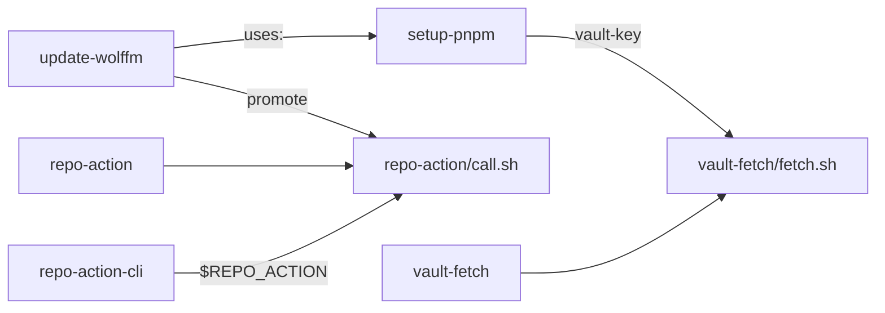

# Contributing

This is a map of the repo and its checks. [`README.md`](../../README.md) has
each action's usage reference; [`features.md`](features.md) has what each one
does, its limits, and the incident that shaped it — read that before changing
one.

## The actions

| Action | What it does |
| --- | --- |
| [`report-job`](../../report-job/action.yml) | Posts a job's outcome to the execution log. |
| [`report-e2e`](../../report-e2e/action.yml) | Parses a Playwright, vitest or pytest report into per-test rows and posts them to the nightly e2e store. |
| [`setup-pnpm`](../../setup-pnpm/action.yml) | Installs Node and the pinned pnpm, and asserts a registry credential is present. |
| [`vault-fetch`](../../vault-fetch/action.yml) | Reads any vault secret at job time, for a caller that isn't `setup-pnpm`. |
| [`setup-python-venv`](../../setup-python-venv/action.yml) | Sets up Python, then builds an isolated throwaway venv. |
| [`repo-action`](../../repo-action/action.yml) | Fast-forwards a bot branch onto the default branch, or sends a release notification. |
| [`repo-action-cli`](../../repo-action-cli/action.yml) | Exposes `repo-action`'s own script as `$REPO_ACTION`, for a caller that must retry it from inside a loop. |
| [`update-wolffm`](../../update-wolffm/action.yml) | Bumps every `@wolffm/*` dependency to latest and promotes the result through `repo-action`. |
| [`publish-npmjs`](../../publish-npmjs/action.yml) | Mirrors an already-built `@wolffm/*` package to npmjs as `@hadoku/*`: this half packs and leak-checks it, and [`publish-npmjs/publish`](../../publish-npmjs/publish/action.yml) is the second, GitHub-hosted half that runs the trusted-publishing handoff. |
| [`next-version`](../../next-version/action.yml) | Computes one patch above the newest published version. |
| [`publish-gate`](../../publish-gate/action.yml) | Skips a publish whose tarball is equivalent to the registry's newest. |
| [`wait-for-live`](../../wait-for-live/action.yml) | Polls a URL until it reports a given version. |
| [`prune-prereleases`](../../prune-prereleases/action.yml) | Deletes a repo's oldest prereleases past a keep count. |

## Layout

```
<action>/action.yml          one composite action per top-level directory
report-e2e/parse.mjs         the report parser report-e2e's action.yml calls
publish-npmjs/prepare.mjs    the pack/rewrite/leak-gate publish-npmjs's action.yml calls
publish-npmjs/public-packages.json   the allow-list prepare.mjs checks against
publish-npmjs/publish/       the second, GitHub-hosted half of publish-npmjs
publish-npmjs/publish/publish.sh   the publish loop that half's action.yml calls
repo-action/call.sh          the HTTP call repo-action, repo-action-cli and
                              update-wolffm all share
vault-fetch/fetch.sh         the vault read, shared by vault-fetch's own
                              action and setup-pnpm's vault path
next-version/next-version.mjs   the version arithmetic, with its own test file
publish-gate/compare.mjs        the tarball comparison, with its own test file
publish-gate/gate.mjs           the skip rules around it (reads next-version.mjs
                              and publish-npmjs/public-packages.json)
.github/workflows/selftest.yml  the one CI workflow: a job per action
.github/selftest/            fixtures and stand-ins the self-test drives:
                              fake-broker.py, fake-e2e-store.py, fake-npm.sh,
                              fake-gate-npm.mjs,
                              and a *-cases.sh per action whose `run:` shell
                              is extracted and tested directly
```

One action is used as a plain step (`uses:`); the rest that depend on each
other call directly into the other action's own script instead:



There is no root `package.json`. Every action is a composite action with a
plain `run:` shell or a `node`/`node -e` one-liner — deliberately no
dependency to install, since nothing here can assume a package manager ran
first.

## Why referenced, not vendored

A local `uses: ./.github/actions/...` is a path into the workspace, so every
caller must run `actions/checkout` first. tenhands' `deploy.yml` was a pure
dispatch job that needed no checkout, and it went red the day it gained that
step (2026-08-30) — the failure was in the very reporter that exists so a
silent failure cannot hide. Referenced instead, the runner fetches the action
before the job's first step: no checkout, one copy, and adding a repo to
coverage is the five lines in [`README.md`](../../README.md#use).

## Running the self-test locally

Several of the `*-cases.sh` scripts under `.github/selftest/` run outside a
runner — e.g. `bash .github/selftest/report-job-cases.sh` extracts
`report-job`'s own shell from `action.yml` and runs it against a stand-in
`curl` that records what it would have sent. That lets the guards — an
unset key warns, a colon-less `job-name` is refused, a `cancelled` outcome
at or past `timeout-minutes` is reported as `failed` — be asserted without
a real runner or a real key. `next-version` additionally has its own unit test,
`node --test next-version/next-version.test.mjs`, covering the version
arithmetic directly. `publish-gate` has two:
`node --test publish-gate/compare.test.mjs publish-gate/gate.test.mjs`, the
comparison's allowed differences (and each real change that could hide behind
one) and every rule that makes the gate ship, run against a stand-in npm.

Most of the other coverage — the `uses:`-based jobs in
[`.github/workflows/selftest.yml`](../../.github/workflows/selftest.yml) —
needs a real GitHub Actions runner and is easiest to exercise by pushing a
branch and letting the workflow run; it fires on `pull_request`, on `push` to
`main`, and on `workflow_dispatch`.

## Tests and gates

`.github/workflows/selftest.yml` is the only workflow and the only gate: one
job per action, run on a GitHub-hosted runner (never self-hosted — a public
repo running pull-request code must not touch a persistent, shared runner).
Each job proves its guards by *firing* them and asserting the step actually
failed, rather than trusting that a guard exists — the review standard
stated throughout the repo: a guard nothing fires reads as coverage. A few
actions state a real gap outright rather than fake coverage for it:
`report-job` and `report-e2e` never POST to the real stores from the
self-test, because a public repo's hosted runner holds no real service key.
Faking that would be worse than a known gap, so the real callers exercise
that path instead. The `publish-npmjs` jobs run the real two-runner handoff with
`npm publish --dry-run`, so nothing is actually published. What a failed
publish is called, and which one is retried, is asserted separately by
running `publish.sh` against a stand-in `npm`
(`.github/selftest/publish-npmjs-publish-cases.sh`).

A few jobs prove more than a single pass/fail. `setup-python-venv` runs
twice: once asserting the contract a caller depends on (the interpreter path,
`PATH`, and the pinned console script all resolve from the throwaway venv),
and once firing the isolation assert both ways — a module outside the venv
and one missing entirely — checking both are caught. `setup-pnpm`'s job
asserts the pins actually landed (`pnpm --version`, `node --version`, a
custom `pnpm-version`) and that an empty credential is refused, by firing it.
`update-wolffm`'s four harnesses run the action's own code directly rather
than a copy: commit-and-promote (a re-run after a landed bump, a real
conflict), the latest-version assert, `resolve-targets.mjs` against a
stand-in `npm` and a local tarball server, and the update step against a
stand-in `pnpm`. `report-e2e`'s harness reads the stand-in store's own
`{"inserted": N}` response back rather than just trusting a `curl` exit code,
and reads the action's own parsed-rows file out of `$RUNNER_TEMP` to confirm
a rerun mapped to `outcome: flaky, attempts: 2`. `vault-fetch` and
`setup-pnpm`'s vault path run against a stand-in broker
(`.github/selftest/fake-broker.py`): a read, a passthrough with no
`vault-key`, a fallback on an unreachable broker, and a 403 failing even with
a fallback set.

None of these call the real store or broker — a public repo's hosted runner
holds no real service key — so `report-job`, `report-e2e` and the vault path
each state that gap outright rather than fake coverage for it; the real
callers across the fleet (`hadoku-contact-ui`, `hadoku-task`, and the first
caller to adopt `vault-key`) exercise it instead.

There is no separate lint or formatter command in this repo — no root
`package.json`, no `.eslintrc`/`.prettierrc`, and no `shellcheck`/`actionlint`
step in `selftest.yml`. The only gate on a change is the self-test above.

## Releasing

`v1` is a release tag, moved deliberately — never a branch alias, and never
by hand. A change lands on `main` once the self-test is green there, and then
moves through an automated release gate elsewhere in the account — the exact
command is in [`README.md`](../../README.md#versioning). That gate refuses a
commit that is not on `main` or whose self-test did not pass, then runs a
handful of real consumers' own build-and-publish path (`hadoku-aggregator`,
`hadoku-contact-ui`, `hadoku-craft`) against the candidate actions with every
pnpm store cold, and moves `v1` only if every one of them is still green. A
dry run of the gate (canaries alone, `v1` left alone) caught a real
regression this way: against the commit right before the fix (`50383ae`) it
was red on all three consumers with the exact 401 issue #5 describes; against
the fix (`64965a1`) it was green. A caller that cannot afford a fleet-wide
break can pin a commit SHA instead of `@v1`.

## Trivia

The self-test workflow (`.github/workflows/selftest.yml`) is the single most
revised file in the repo after `README.md` itself — 23 separate commits touch
it (`git log --oneline -- .github/workflows/selftest.yml | wc -l`, run
2026-11-16), nearly one for every behavioral change any action made.
